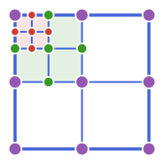

# Multilevel Kernel Interpolation

<p align="center">
  
</p>

[](https://djukic14.github.io/MultilevelKernelInterpolation.jl/stable/)
[](https://djukic14.github.io/MultilevelKernelInterpolation.jl/dev/)
[](https://github.com/djukic14/MultilevelKernelInterpolation.jl/actions/workflows/CI.yml?query=branch%3Amain)
[](https://codecov.io/gh/djukic14/MultilevelKernelInterpolation.jl)
[](https://github.com/JuliaTesting/Aqua.jl)

## Introduction

The [MultilevelKernelInterpolation.jl](https://github.com/djukic14/MultilevelKernelInterpolation.jl)
package uses multilevel polynomial interpolation to accelerate products with
kernel-based matrices, such as those arising from
the boundary element method (BEM). The built-in assemblers use
integral operators and function spaces from [BEAST](https://github.com/krcools/BEAST.jl).
It approximates well-separated interactions with polynomial bases and computes
nearby interactions directly,
so matrix-vector products do not require the full dense matrix.

The package provides:

* **Polynomial bases**: Equidistant and Chebyshev Lagrange polynomials, and B-splines with buffering and stabilization.
* **Translations**: Parent-child transfers and dense or FFT-based Toeplitz couplings, with symmetry reduction for supported configurations.
* **Moment assembly**: Integrals of the polynomial bases against the test and trial functions.
* **Galerkin and Petrov-Galerkin maps**: Construction with matching or different test and trial spaces.

Given a surface mesh `mesh`, construct and apply a Maxwell single-layer map with:

```julia
using MultilevelKernelInterpolation
import BEAST

space = BEAST.raviartthomas(mesh)
op = BEAST.Maxwell3D.singlelayer(; wavenumber=1.0)
A = GalerkinKernelInterpolation(op, space)

x = ones(eltype(A), size(A, 2))
y = A * x
```

Use `MultilevelKernelInterpolation.InterpolationStrategy` to choose the polynomial basis, translations, and quadrature.
[H2Trees](https://github.com/djukic14/H2Trees.jl) organizes the geometry;
[H2Factory](https://github.com/djukic14/H2Factory.jl) handles the tree passes and workspaces.

## Documentation

* Documentation for the [latest stable version](https://djukic14.github.io/MultilevelKernelInterpolation.jl/stable/).
* Documentation for the [development version](https://djukic14.github.io/MultilevelKernelInterpolation.jl/dev/).
* [Choosing a basis](docs/src/polynomials/choosing.md) and [configuring a map](docs/src/guide/approximation.md).
