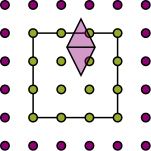

# B-splines

B-splines have local support. Their degree `p` controls the shape of each
piece; the basis count `b` controls how finely the interval is divided.
Increasing `b` does not require increasing `p`.

```julia
poly = MultilevelKernelInterpolation.BsplinePolynomialEquidistant(dim=3, degree=3, nbasis=9)
```

The [basis explorer](choosing.md) shows these functions. The plain constructor
above provides neither buffers nor the buffered stabilization described below.

## Cover protruding supports

Use `BufferedBsplinePolynomialEquidistant` when basis-function supports extend
outside their assigned boxes. It adds knots around the box while preserving
the uniform spacing needed by Toeplitz I2O.

```julia
buffered = MultilevelKernelInterpolation.BufferedBsplinePolynomialEquidistant(
    dim=3, degree=3, nbasis=9,
    buffer=MultilevelKernelInterpolation.AutoBufferFromProtrusion(),
)
```



`AutoBufferFromProtrusion` chooses the buffer from geometry during tree
construction. `ExplicitBuffer(n)` fixes the count per side; `NoBuffer()`
requests none. The [I2I page](../transfers/i2i.md#Buffers-across-levels)
explains how these policies behave across levels.

`MultilevelKernelInterpolation.numbufferpoints(buffered)` reports the constructed count.
`MultilevelKernelInterpolation.realizedprotrusion(buffered)` reports the resulting domain extension.
The raw basis count can exceed the requested `nbasis` because of these buffers.

## Values are not coefficients

Let `b_j` be the spline basis and `t_i` its sample points. To approximate a
function from its values, solve

```math
S c = v,\qquad S_{ij}=b_j(t_i),\qquad v_i=f(t_i).
```

`MultilevelKernelInterpolation.interpolationmatrix(poly)` returns `S`: **sample rows, basis columns**.
For the plain basis, sampled values satisfy `v = S*c`. Lagrange's cardinal
basis would give the identity here; B-splines generally do not.

This example reconstructs a function in the spline space:

```@eval
using MultilevelKernelInterpolation
Base.include(@__MODULE__, joinpath(pkgdir(MultilevelKernelInterpolation), "docs", "plotutils.jl"))
displayedcode(joinpath(pkgdir(MultilevelKernelInterpolation), "docs", "plots", "spline_solve.jl"))
```

```@raw html
<object data="../../assets/plots/spline_solve.html" type="text/html" class="guide-plot" aria-label="Interactive figure"><a href="../../assets/plots/spline_solve.html">Open interactive figure</a></object>
```

It checks the representation, not a general interpolation-error bound.

## Stabilize the sampling system

Uniform samples do not guarantee a well-conditioned system at high degree.
The buffered implementation removes selected interior knots near each
boundary to form a smaller basis for kernel interpolation. **Buffering
covers geometry; knot removal improves the sampling system.**

Moments and level transfers retain the raw basis. Only I2O uses the reduced
basis, with conversions before and after the coupling:

```text
raw moments -> conversion -> reduced moments
     |                            |
 I2I / O2O                 kernel interpolation
```

`MultilevelKernelInterpolation.knotstoremove(degree, nbasis)` chooses the number removed per boundary.
The current default policy covers degrees 1–10; degrees 1 and 2 remove no
knots. Removal is also skipped when the basis is too small.

`MultilevelKernelInterpolation.interpolationmatrix(buffered)` returns the reduced sampling matrix when
removal is active. Its column count can differ from the raw moment size.
Fewer functions remain after removal, so stabilization trades some
approximation space for better conditioning at a fixed raw count.

## Use the basis in I2O

For the square, unreduced case, kernel samples `G` and coupling coefficients
`W` satisfy

```math
S_{\mathrm{test}}\,W\,S_{\mathrm{trial}}^{\mathsf T}=G.
```

MultilevelKernelInterpolation applies the conversions one axis at a time. The
[B-spline I2O page](../coupling/bspline.md) explains both dense and Toeplitz
routes, including the reduced basis.
