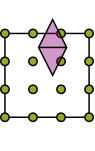
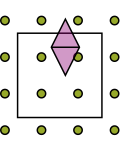

# Lagrange interpolation

A Lagrange basis has one function for each interpolation node. At its own
node that function is one; at the other nodes it is zero. Consequently,
the interpolation coefficients are just the sampled function values.

For I2O, this means the coupling matrix contains kernel samples between the
receiving and source grids. There is no additional sampling-matrix solve.

```math
\ell_j(t_i)=\delta_{ij},\qquad
f(x)\approx\sum_j f(t_j)\ell_j(x).
```

The identity at the nodes is exact; approximation between them depends on
the function and the chosen nodes.

## Choose the nodes

```julia
equidistant = MultilevelKernelInterpolation.BarycentricLagrangePolynomialEquidistant(dim=3, order=6)
chebyshev = MultilevelKernelInterpolation.BarycentricLagrangePolynomialChebyshev(dim=3, order=6)
chebyshev2 = MultilevelKernelInterpolation.BarycentricLagrangePolynomialChebyshev2(dim=3, order=6)
```

Equidistant nodes give the regular grid needed by Toeplitz I2O. At high degree,
however, interpolation can develop large oscillations: the Runge phenomenon.
Increasing the degree is therefore not always an improvement.

Chebyshev nodes cluster towards the ends of the interval and avoid that
particular equidistant-node difficulty. Use dense I2O with these families;
their nonuniform grid does not support the Toeplitz route.

The first Chebyshev family uses interior roots; the second includes both
endpoints. Here are all three grids, generated by their constructors:

```@eval
using MultilevelKernelInterpolation
Base.include(@__MODULE__, joinpath(pkgdir(MultilevelKernelInterpolation), "docs", "plotutils.jl"))
displayedcode(joinpath(pkgdir(MultilevelKernelInterpolation), "docs", "plots", "node_choices.jl"))
```

```@raw html
<object data="../../assets/plots/node_choices.html" type="text/html" class="guide-plot" aria-label="Interactive figure"><a href="../../assets/plots/node_choices.html">Open interactive figure</a></object>
```

## What barycentric evaluation does

All three constructors use the barycentric formula to evaluate the basis.
It avoids constructing monomial coefficients. It does not change the nodes
or remove Runge instability from equidistant interpolation.

The methods are `MultilevelKernelInterpolation.evaluateall1dpolynomial!` and
`MultilevelKernelInterpolation.evaluateall1dpolynomialderivative!`. The [basis explorer](choosing.md)
uses the same nodes and basis conventions, checked against the Julia evaluator.

## When support extends beyond the box

A tree assigns a basis function to a box, but the function's support may
extend outside it. The sketch below shows such an function.



Lagrange polynomials can be evaluated outside their reference interval.
This extrapolation retains the original grid, but may amplify errors.
Another option is to enlarge the interpolation domain:



`MultilevelKernelInterpolation.ScaledShiftedPolynomial` wraps a basis with a scale and shift.
The constructor expresses the sampling coordinates as
`x[d] * scaling + shift[d]`. Neither enlargement nor extrapolation is a
general cure for Runge instability.

Enlarging the domain also brings the sampling points closer to other boxes.
MultilevelKernelInterpolation checks their separation during construction with
`MultilevelKernelInterpolation.checkprotrusionsafety`. The coordinate mapping itself is described in
the [basis introduction](choosing.md#From-the-reference-interval-to-a-box).
